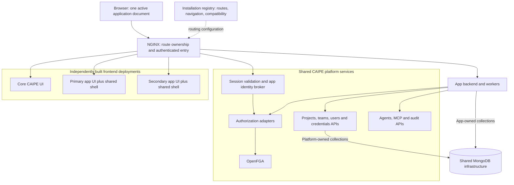
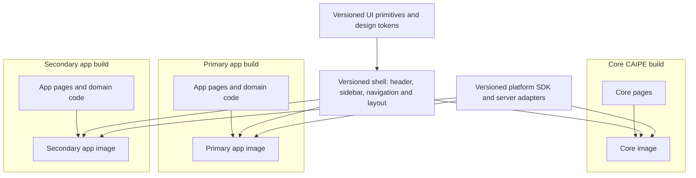
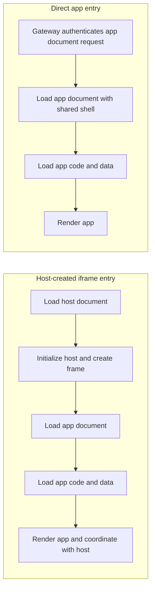
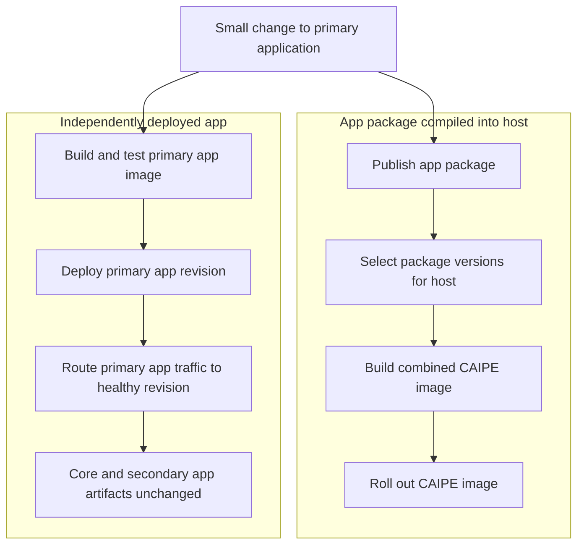
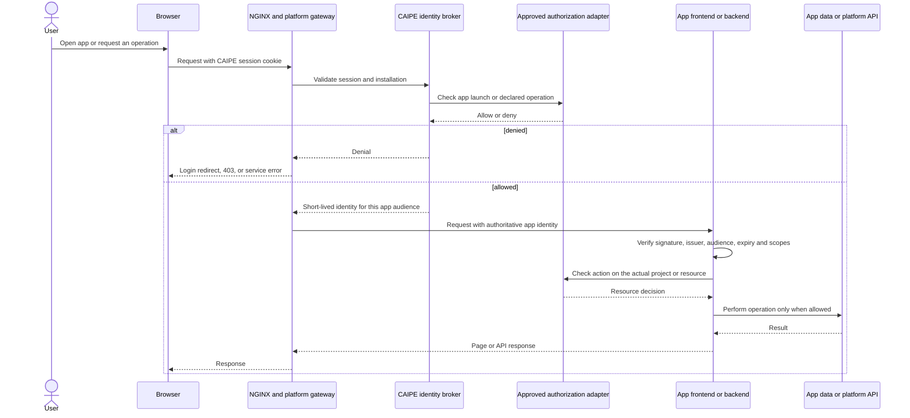
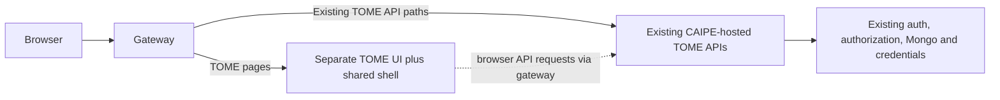
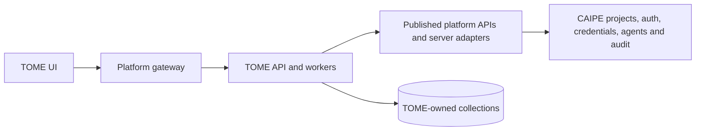

# Proposal: independently deployed app plugins for CAIPE

**Status:** architecture proposal, 2 October 2026. The package names, installation
contract, and new gateway interfaces below are proposed APIs. This document does
not implement them or report new performance measurements.

## Recommendation

Give each application its own frontend deployment and URL namespace. Build the
shared CAIPE navigation and visual shell into that application through versioned
packages. Route requests to the correct application at the gateway.

For the first implementation, use **Next.js Multi-Zones, an external NGINX
gateway, and ordinary versioned React/TypeScript packages**. Each application
renders directly as the browser's main document. CAIPE continues to provide
identity, authorization, projects, credentials, and shared platform services.

- An application UI change builds and deploys that application only.
- Opening an application loads its page directly, including the common shell.
- Navigation inside the application uses its normal client router.
- Switching between applications loads a new document and reconstructs the shell.
- Application code does not enter the core CAIPE UI build.
- There is no browser plugin loader, remote-module negotiation, or Module
  Federation dependency in this design.

**The firm benefit is release independence. The expected performance benefit is
less startup work than a shell-plus-iframe implementation. A controlled benchmark
must establish the size of that benefit.** A persistent, well-optimized iframe
can already be fast; this proposal does not claim that removing an iframe makes
Markdown rendering intrinsically faster.

## 1. The architectural decision

The useful distinction is where applications are composed:

| Approach | Composition happens in | Application update | Main trade-off |
|---|---|---|---|
| Embedded iframe | A host document containing an app document | Deploy app independently | Additional document lifecycle and host/child coordination |
| Proposed native package in CAIPE | The CAIPE frontend build | Rebuild and release a derived CAIPE image | Shared React tree, coupled releases |
| **This proposal: routed applications** | The HTTP gateway | **Build and release the app image** | Full document navigation when crossing application boundaries |
| Browser runtime composition | A module loader in the host browser | Publish/load remote app bundles | Runtime compatibility and loading machinery |

This follows the concern in
[Shubham's comment on discussion #2853](https://github.com/orgs/caipe-io/discussions/2853#discussioncomment-18713829):
separate source repositories do not provide independent releases if every app
change still requires a downstream CAIPE build and rollout. CI automation and
build caches reduce waiting; they do not remove that dependency.

The [native package proposal](https://github.com/orgs/caipe-io/discussions/2853)
provides useful shared UI and contract ideas. Keep those ideas, but make the app
consume the shell package instead of making CAIPE consume every app package.
Preserve the independently owned services and platform integration boundary from
the [External Apps discussion](https://github.com/orgs/caipe-io/discussions/2593).

This is a recommended model for **full applications**: knowledge workspaces,
operations consoles, planning tools, or reporting products. It does not provide
arbitrary independently released React widgets inside an existing CAIPE page.

## 2. System architecture



The gateway routes requests; it does not assemble React components. The app's
frontend and backend may initially share one deployment if that suits the app.
Separate deployments become useful when workers or APIs need different scaling.

The installation registry contains **configuration data**, such as routes,
navigation entries, and approved service destinations. It does not contain
JavaScript URLs for executable modules loaded into CAIPE.

### What the user experiences

1. Sign into CAIPE once.
2. Select an authorized application from the common navigation.
3. The gateway serves that application's document with the same CAIPE chrome.
4. Move between its catalog, documents, settings, and editor using local client
   navigation.
5. Open another application using a normal document navigation.

There is visual continuity across applications, but **the shell is not one
continuously mounted React instance**. Global chat state, open menus, editor
buffers, and in-memory stores do not automatically survive that boundary.
Durable state belongs in the appropriate service; unsaved edits need a navigation
guard. Keeping a live media player or chat session mounted across every app would
require a different composition choice.

## 3. Shared code without a shared release

The key dependency direction is:



Proposed packages:

| Package | Responsibility | Boundary |
|---|---|---|
| `@caipe/ui` | Buttons, dialogs, forms, typography, design tokens | Presentation; no private application imports |
| `@caipe/shell` | Header, sidebar, breadcrumbs, navigation, theme integration | Receives public data and callbacks |
| `@caipe/sdk` | Typed platform API clients and public contracts | Separate browser-safe and server-only exports |
| `@caipe/next` | Next.js integration for shell, request identity, and routing | Optional framework adapter |

These would be ordinary packages with compiled JavaScript, types, explicit CSS
assets, and compatible React peer dependencies. Each app pins versions and runs
its own build. Framework-specific code stays in the adapter; the public HTTP
contracts also support applications using other frontend frameworks.

Existing shell components are not already this clean package boundary.
`ui/src/components/layout/AppHeader.tsx` imports private session hooks, dialogs,
configuration, and stores. `WorkspaceShell.tsx` registers React content through a
host context. Extraction must replace these private dependencies with explicit
props, callbacks, and public services. Packaging the current dependency tree
unchanged would carry much of the host into every app.

### Changes and their build impact

| Change | Required build/release |
|---|---|
| App page, Markdown component, or app workflow | That app |
| App backend implementation | That backend, or the app image if combined |
| Enable/disable an installed app or change a permitted navigation label | Registry/configuration update |
| Theme values supported by the existing theme contract | Configuration update |
| Shared shell component implementation | Publish shell package; rebuild consuming apps when they adopt it |
| Breaking platform API change | Coordinated compatibility transition |
| Security fix in shared frontend code | Rebuild affected consumers promptly |

Independent delivery does not mean shared code never needs coordinated updates.
It means an ordinary app change does not force unrelated apps and core CAIPE
through a release.

## 4. Routing and installation contract

Use a stable application namespace. An illustrative installation could route:

| External path | Owner |
|---|---|
| `/apps/example/*` | Example app documents and app-local framework requests |
| `/app-assets/example/*` | Example app assets |
| `/api/apps/example/*` | Authenticated gateway to the example app API |
| `/api/platform/*` | Versioned shared platform API; proposed namespace |
| `/api/auth/*`, core administration, other core routes | CAIPE |

The public origin could be `https://platform.example.com`. Private services stay
behind the gateway. Route destinations come from operator-controlled installation
data, with conflict checks before activation.

This is an **illustrative new installation schema**, not existing Helm values:

```yaml
apiVersion: apps.caipe.io/v1alpha1
kind: ApplicationInstallation
metadata:
  name: example
spec:
  frontend:
    service: example-ui
    routePrefix: /apps/example
    assetPrefix: /app-assets/example
  backend:
    service: example-api
    routePrefix: /api/apps/example
  navigation:
    label: Example application
    href: /apps/example
  compatibility:
    platformApiMajor: 1
    shellContractMajor: 1
  capabilities:
    - projects.read
    - agent-runs.create
```

Capability names are illustrative. A declaration requests an allowed integration
surface; it does not grant access to all projects or authorize an individual user.

### Next.js behavior and constraints

[Next.js Multi-Zones](https://nextjs.org/docs/app/guides/multi-zones) supports
independent applications behind one domain, with client navigation within a zone
and document navigation between zones. Use regular anchors between applications
and the app's router for its own pages. Group frequently visited pages inside the
same application. This can run behind an HTTP proxy without adopting a particular
hosting provider.

Our routing contract should require:

- A stable route prefix declared by the app artifact. If `basePath` is used, it is
  a build-time setting; changing the mount is an app rebuild, not an arbitrary
  registry edit. See [Next.js basePath](https://nextjs.org/docs/app/api-reference/config/next-config-js/basePath).
- Unique static asset URLs. `assetPrefix` covers Next.js static bundles, but does
  not automatically fix every public image or API URL. Namespace these explicitly.
  See [Next.js assetPrefix](https://nextjs.org/docs/app/api-reference/config/next-config-js/assetPrefix).
- Correct handling of deep links, refresh, query strings, redirects, framework
  data requests, image optimization, and trailing slashes.
- Streaming, RSC requests, and server actions tested through the real proxy if
  used. Preserve their required headers and configure the external origin.
- Exclusive route ownership. Core auth/admin paths cannot be claimed by an app.
- Routing configuration outside the CAIPE frontend bundle. Generating a new host
  build for every route change would recreate the release dependency.

An application does not import RSC trees or server actions from another running
application. It uses the other's supported API.

## 5. Where performance can improve

### Cold application entry

The following is a conceptual dependency comparison, **not a measured timeline**.
Real implementations can overlap some work.



The routed app can avoid loading core CAIPE's application code merely to create
another document. It also avoids host/child messaging for navigation, theme,
height, and other shell coordination. App-specific SSR, streaming, lazy loading,
and data fetching remain available within an ordinary Next.js application.

An iframe creates another browsing context and has resource overhead, but browser
documentation does not establish a universal slowdown multiplier.
[MDN: iframe](https://developer.mozilla.org/en-US/docs/Web/HTML/Reference/Elements/iframe)
describes that overhead; it does not justify a claim that document-heavy apps are
always five to twenty times slower.

### What this does not speed up by itself

- Markdown parsing, syntax highlighting, document indexing, and editor work still
  take time. They need their own profiling and chunking decisions.
- Slow database, authorization, or transcript calls remain slow.
- A persistent iframe can keep its own router and application state warm.
- Both models can use compression, immutable assets, prefetching, and lazy loading.
- Gateway authentication adds latency; measure it rather than treating it as free.
- Frequent switching between apps may be slower than keeping several iframes
  mounted, because this design reconstructs the destination document.

For TOME, the expected favorable workload is **enter the workspace, then spend
most of the session navigating documents inside it**. If the real workload is
constant switching between unrelated apps while preserving live UI state, this
choice needs reconsideration.

### What the supplied benchmarks actually establish

These are selected measurements supplied with the request. They were collected
in different experiments; raw per-run traces were not retained.

| Experiment and operation | Recorded result | Supported conclusion |
|---|---|---|
| Original authenticated catalog reload | GRID p50 131 ms; iframe p50 916 ms | That iframe implementation had substantially slower entry |
| Original authenticated project open | GRID p50 834 ms; iframe p50 2,293 ms | That workload had about 2.75 times the latency |
| Project open after iframe fixes | Iframe p50 592 ms; later GRID p50 698 ms | The optimized iframe sample was faster in that comparison |
| Local native PoC cold catalog | Native p50 372 ms, p95 1,052 ms; local iframe baseline about 993 ms p50 | Promising local entry result, with substantial tail latency |
| Local native PoC internal document navigation | Charter p50 49 ms; Roadmap p50 34 ms | Fast warm navigation was demonstrated inside that app |

These results support investigating startup and navigation architecture. They do
not isolate an inherent iframe penalty or predict this proposal's production
speedup. In particular:

- Compare the same operation under the same conditions. A warm document switch
  cannot be compared to a cold project entry.
- Do not combine component medians to reconstruct an end-to-end percentile.
- Five runs do not provide a robust estimate of tail latency.
- HTTP load-test latency is not browser navigation latency.
- A smaller entry bundle can defer work into route chunks; it does not prove that
  total downloaded JavaScript shrank.

The goal is to retain the native PoC's direct document and app-local navigation
benefits while moving the application build out of CAIPE's build.

## 6. Independent development, releases, and rollback



### Daily development

1. Run the app's own development server with hot reload.
2. Run a local gateway configuration that routes the app prefix to that server
   and platform API requests to an approved development CAIPE environment.
3. Use real shared-package versions and the same public integration contracts as
   production.
4. Test the app without rebuilding or restarting core CAIPE.

This separates two requirements: hot reload during development and independent
production delivery. Build-time package systems can also support isolated hot
reload; the production release boundary is the additional benefit here.

### App delivery pipeline

1. Typecheck and test the app; validate its declared platform contract.
2. Build its container and assets, pinning dependencies and image digest.
3. Run browser conformance tests through the gateway: auth, deep links, assets,
   navigation, and critical app operations.
4. Deploy the app revision and run readiness/smoke checks.
5. Promote its traffic. CAIPE and other apps retain their existing image digests.

Rollback selects the previous app revision and its matching assets. It does not
roll back unrelated application changes. Backend/schema compatibility still
governs whether rollback is safe; separate deployment does not solve that
automatically.

Operators still approve installations, provide resources, and manage platform
contracts. Routine approved app updates can use the app's delivery pipeline
without becoming a platform UI release.

## 7. Authentication and authorization remain shared

Users retain their CAIPE login. Apps receive verified, bounded identity through
the platform gateway; they do not need CAIPE's session-signing secret.



For HTML entry, NGINX can use an internal authorization subrequest and pass the
resulting identity to the app server. The
[NGINX auth request module](https://nginx.org/en/docs/http/ngx_http_auth_request_module.html)
provides the allow/deny mechanism; CAIPE must implement the session validation,
app policy, and identity issuance behind it. Verify module availability in the
chosen gateway image.

This is a proposed integration around existing CAIPE helpers, not an endpoint
that already exists. API requests continue through a policy-enforcing gateway.

The contract must preserve these properties:

- The authenticated stable subject identifies the user. Email and display name
  are presentation data, not substitutes for the identity key.
- The gateway removes caller-supplied identity headers and controls the signed
  assertion sent to the app. Apps verify it on every applicable request. Keep the
  raw platform session cookie on the validation hop rather than forwarding it to
  app upstreams that only need the assertion.
- Tokens have an explicit audience, lifetime, and permitted scope. Prefer public
  key verification so app services do not receive a platform-wide signing secret.
- The browser does not receive provider refresh tokens or a broad internal bearer
  token as part of shell initialization.
- Being allowed to launch an app does not grant access to every project in it.
  Resource checks use the existing approved authorization adapters.
- Mutations retain CSRF/origin protection. A shared cookie is not enough to
  authorize a cross-site POST.
- Machine callers, webhooks, and scheduled workers have explicit authentication
  contracts; they cannot depend on an active browser session.

For SSR or backend calls into platform APIs, the server SDK must use a supported
delegation contract that authenticates both the app workload and the caller's
permitted context. An app-audience token is not a universal platform API token;
obtain an assertion for the intended service or use a gateway that explicitly
validates that delegation. Do not solve this by forwarding the original browser
session or accepting an arbitrary user ID from the app.

Keycloak token exchange is a possible implementation of the identity broker,
subject to the deployed version and configured policy. Exchange must enforce the
intended audience and scope; exchanging a token does not automatically make it
least-privilege. See [Keycloak token exchange](https://www.keycloak.org/securing-apps/token-exchange).

### Same origin means trusted application code

An application served under another path on the same origin is not a browser
security sandbox. Its JavaScript can make same-origin requests with ambient
cookies. Path routing and Shadow DOM do not change this trust relationship.
See [same-origin policy](https://developer.mozilla.org/en-US/docs/Web/Security/Defenses/Same-origin_policy).

Use this mode for applications trusted to participate in the CAIPE origin. Keep a
separate-origin, appropriately sandboxed iframe option for applications needing
browser isolation. Server-side authorization remains required in both modes.

## 8. OpenFGA, MongoDB, credentials, and agents

**Separating the UI does not require replacing these services.** Define ownership
and supported interfaces while keeping the existing infrastructure where useful.

| Capability | Platform responsibility | App responsibility |
|---|---|---|
| Login and session | Identity provider and session validation | Consume verified identity |
| OpenFGA | Authorization model and approved adapters | Request checks for concrete resources/actions |
| Projects, teams, users | Canonical records and APIs | Reference stable IDs; avoid a parallel project directory |
| App data | Shared Mongo infrastructure if desired | Own its collections, indexes, and data contract |
| Connected credentials | OAuth connection storage, refresh, revocation, and controlled use | Request an authorized provider operation or bounded credential delegation |
| Agents and MCP | Execution interfaces and their authorization | Submit app workflows with the correct user/workload context |
| Audit | Shared correlation and event contract | Emit app-domain events without credentials or transcript bodies |

The same OpenFGA deployment, store, and existing relationships can remain in use.
Centralize checks and relationship writes behind the approved CAIPE adapters.
Applications should not independently edit the global authorization model or
receive unrestricted tuple-write access. OpenFGA's
[store and model concepts](https://openfga.dev/docs/concepts) describe the shared
infrastructure; application ownership is a platform design decision.

The same Mongo cluster can also remain in use. App services may have access to
their own collections through restricted database credentials or a data service.
They use supported platform APIs for platform-owned collections. Sharing a Mongo
server does not require sharing unrestricted database credentials or private
TypeScript imports.

Scheduled ingestion needs particular care: retain the recorded execution owner,
project authorization, provider connection selection, refresh behavior, and
revocation checks. An app worker must obtain permitted access through the
credential service using an authenticated workload and validated delegation.
It must not impersonate an arbitrary subject from a request body.

## 9. TOME extraction: practical stages

### What the current code tells us

The current frontend/backend boundary is intertwined:

- `ui/src/lib/tome/tome-api.ts` authenticates requests, resolves the CAIPE project,
  and obtains TOME permissions. It explicitly reuses the platform project entity.
- `ui/src/lib/tome/mongo-collections.ts` wraps shared Mongo access for TOME-owned
  records keyed by project ID.
- `ui/src/lib/tome/managed-webex.ts` uses the shared provider connection service.
- `ui/src/lib/tome/auto-ingest/scheduler.ts` and `ui/src/instrumentation.ts` connect
  background work to the UI server lifecycle.
- TOME pages consume private layout components and host navigation contexts.

These are real extraction tasks. Copying the pages into another repository does
not remove those dependencies.

### Stage 1: make UI releases independent



- Extract the presentation shell and public browser contracts.
- Move a coherent workspace flow into an independent app: catalog, project,
  document navigation, settings, and ingest screens.
- Keep existing backend API implementations and authorization behavior initially.
- Establish gateway entry authentication, route ownership, and assets.
- Prove that changing the TOME UI leaves the CAIPE image unchanged.

**This stage provides independent UI delivery but still leaves TOME backend code
inside the fork.** It is an intermediate result, not the final plugin architecture.

### Stage 2: make domain services independent



- Move TOME domain APIs and worker lifecycle into app-owned services.
- Replace imports of private platform Mongo, auth, and credential modules with
  supported server adapters or APIs.
- Retain stable project IDs and the existing authorization relationships.
- Move scheduler ownership deliberately so two deployments cannot run competing
  schedulers for the same work.
- Keep the platform's project directory canonical.

Any transition that changes existing records, scheduler ownership, or persisted
run state needs a separate, explicit operational plan and approval. This proposal
does not authorize data migration, backfill, recovery, or automatic repair.

### Route ownership needs an inventory

The current `/projects` namespace includes both generic project functionality and
TOME behavior. Do not assign the entire namespace to TOME without examining its
routes. Prefer a dedicated app prefix for the initial extraction, then explicitly
design compatibility aliases for existing deep links. Core administration remains
owned by CAIPE.

The upstream deliverable is the generic shell, integration contracts, gateway
support, and app template. TOME's private domain implementation can then live in
its own repository without requiring private changes to the core UI.

## 10. Deployment details that affect correctness and speed

| Concern | Required behavior |
|---|---|
| HTML and API caching | Preserve user/resource boundaries; no shared cache of personalized pages |
| Static assets | Content-hashed, compressed, and cached according to an explicit visibility policy |
| Rollout asset skew | Old pages can still fetch their referenced chunks during the supported rollout window |
| Framework request skew | Requests requiring a particular build reach a compatible app revision, or trigger a controlled reload |
| Rollback | Restore a matching app image and asset set; verify API/schema compatibility |
| Streaming | Proxy supports the app's streaming responses and cancellation behavior |
| Failure isolation | An unavailable app gets an app-level error; core pages remain routable |
| Compatibility | Installation validates API/shell contract versions before serving traffic |
| Observability | Correlate gateway, authorization, app, and backend timings by request ID |

There is a concrete caching issue to address during the prototype:
`ui/src/app/api/agentic-apps/runtime/[appId]/[[...path]]/route.ts` currently sets
`Cache-Control: no-store` on proxied responses. Sending immutable app bundles
through that policy would undermine caching. Separate the document/API policy
from the static-asset policy, including an explicit decision about whether assets
themselves require authenticated delivery.

Likewise, the existing iframe-oriented gateway filters response headers. Its
helpers and policy checks are useful, but forwarding a Next.js application needs
validation of CSP, redirects, cookies, streaming, and framework headers. It is not
safe to assume that changing the destination alone completes the integration.

Keep old hashed assets available for the rollout window; merely having new pods
ready does not protect an old browser tab from missing chunks. Mutable framework
requests need their own version-skew strategy. This is a per-app delivery concern,
not a reason to rebuild CAIPE.

## 11. Why other approaches are not the default here

| Approach | Useful when | Why it does not fully satisfy this requirement |
|---|---|---|
| Static native packages in CAIPE | One React tree and coordinated releases are acceptable | App changes still enter the host build |
| Build caching or a monorepo | Improving an existing build pipeline | Reduces build work but does not change the release boundary |
| Web Components | Framework-neutral widgets or reusable UI elements | Component encapsulation alone does not define loading, auth, routing, or independent releases |
| Runtime module loading / Module Federation | Independent fragments must coexist inside one live page | Adds the browser composition and compatibility machinery we want to avoid for full apps |
| Persistent iframe | Stronger document separation or persistent outer shell is valuable | Retains two document lifecycles and integration coordination |
| Separate app subdomains | Stronger origin separation or independent branding is desired | Needs additional cross-origin session/API and navigation integration |

Web Components may still be useful for small shared controls, but they are not a
prerequisite. Shadow DOM provides encapsulation of markup and styling; it is not
a security boundary or an application delivery architecture.
[MDN: Shadow DOM](https://developer.mozilla.org/en-US/docs/Web/API/Web_components/Using_shadow_DOM)
explains that component mechanism.

The decision changes if the requirement becomes “independently deploy a plugin
that modifies an arbitrary part of the currently mounted CAIPE React page.” The
routed-app model intentionally does not promise that extension surface. Keep
navigation entries, badges, and other simple contributions data-driven; evaluate
richer embedded contributions separately.

## 12. Prototype and benchmark plan

### A representative vertical slice

Build an isolated prototype covering authenticated catalog entry, project entry,
Markdown navigation, one editor operation, and one resource-protected API. Use a
single extracted implementation where practical so rendering changes do not
confound the architecture comparison.

Compare three production builds:

1. Optimized persistent iframe, with working caching and navigation.
2. Native package compiled into the host, as a reference.
3. Independently deployed app using this proposal.

Use the same user, authorization state, dataset, backend services, network
conditions, and compression settings. Separate browser-cold, browser-warm,
server-cold, and server-warm conditions. Randomize test order and retain raw traces.

### Measure actual user operations

| Operation | Start | Completion criterion |
|---|---|---|
| Cold deep link | Navigation begins | Authorized document content is visible and usable |
| First app entry from CAIPE | User activates app link | App content is usable |
| Project open | User selects project | Project content is usable |
| Warm document switch | User selects document | Target document is visible and interactive |
| Large document/editor | User opens or edits content | Render/edit completes without unacceptable interaction delay |
| Return to core | User activates core link | Core destination is usable |
| Repeated app switching | Alternating navigation sequence | Latency, memory, and state behavior recorded for each step |

Record at least 50–100 samples per main condition as a starting point, then extend
sampling where variability remains high. Report sample counts, p50/p95, failures,
and uncertainty. A percentile from a small sample should not be treated as a
stable service objective.

Capture the network waterfall, authorization time, HTML wait, JavaScript
download/parse, API wait, rendering time, long tasks, transferred bytes, and memory.
Use explicit application marks for “content usable”; a skeleton is not completion.
Instrument iframe content as well as its parent: parent-only event measurements
can miss interactions inside frames. See [web.dev on INP](https://web.dev/articles/inp).

### Acceptance gates

- **Release independence:** deploy and roll back a visible app change while core
  CAIPE and another app keep the same image digests.
- **Developer independence:** app hot reload works without a host build.
- **Authorization parity:** allowed and denied users get equivalent resource
  decisions, including direct deep links and API calls.
- **Integration parity:** project IDs, credential selection, and background-work
  ownership preserve their intended semantics.
- **Performance:** establish a repeatable cold-entry improvement over the optimized
  iframe, with no material regression in app-local navigation. Agree numerical
  thresholds after collecting a controlled baseline.
- **Cross-app experience:** document reload latency and state loss are acceptable
  for the actual user workflow.
- **Operational correctness:** deep links, refresh, asset skew, and rollback pass
  through the production-style proxy.

If the optimized iframe performs equally well, release independence still favors
this approach over a host-compiled package, but performance alone would not
justify extracting an existing iframe app. Report that result honestly.

## 13. Suggested implementation order

1. **Agree the boundary.** Full-page apps, stable route ownership, shared platform
   services, trusted same-origin code, and document navigation between apps.
2. **Extract the smallest shell contract.** Start with navigation, layout, theme,
   identity display, and breadcrumbs; keep private app behavior out of it.
3. **Build the representative prototype.** Reuse the existing TOME backend first.
4. **Verify auth and routing.** Exercise denied access, deep links, framework
   requests, streams, and static caching through the gateway.
5. **Run the controlled comparison.** Publish traces and results for the three
   implementations, including cross-app transitions.
6. **Publish the generic app template and SDK.** Provide local hot reload,
   contract tests, image build, installation, and rollback workflows.
7. **Extract TOME services incrementally.** Plan state and scheduler transitions
   separately before removing the remaining fork dependency.

The architecture decision should be approved on two independent questions:
whether the release boundary meets the product requirement, and whether the
measured navigation experience meets the performance requirement. This proposal
provides a direct way to test both before committing to a broad extraction.
