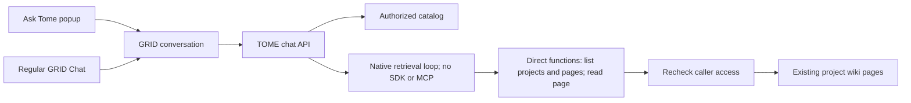

# TOME chat and ingestion

One native service runs project ingestion/chat with Claude Agent SDK and global
Ask Tome with a direct Messages retrieval loop. It needs no agent per project or
separate retrieval deployment.

| Operation | Context | Session and files |
| --- | --- | --- |
| Project ingestion | Project snapshot and authorized source credentials | A run for that project; its own wiki workspace |
| Project chat | Project snapshot, stable pages, and permitted references | A resumable chat session; project workspace |
| BHAG/area chat | Rollup snapshot and authorized child projects | Its own chat session; child wikis are read-only references |
| Global Ask Tome | Caller-readable catalog with BHAG/area relationships | A user/conversation session; current pages retrieved through tools |

## Global retrieval

- The initial context contains entity names, types, slugs, and hierarchy labels.
- The agent retrieves relevant wiki and source-specific pages on demand and cites
  their project/page paths. It reports gaps and the scope it actually inspected.
- Global retrieval creates no workspace, subprocess, SDK session, or MCP server.
  The model receives three direct functions and cannot select URLs, credentials,
  shell commands, filesystem reads, or writes. This is a restriction on callable
  operations, not a separate operating-system sandbox.
- The backend checks current caller access on every read. The retrieval loop
  revalidates its access scope before model calls and before exposing replies.
  An access change stops the turn; the next turn starts with empty model history.
- Mongo stores at most eight user/assistant messages per user/conversation, with
  a seven-day TTL and a lease that serializes active turns. Raw source pages and
  function results stay in turn memory; they are never resumed from SDK files.
- Reads return at most 24,000 characters per page chunk. Each turn is limited to
  12 model calls, 32 reads, and 100,000 characters of retrieved evidence.
- GRID keeps visible messages and tool timelines; shared conversation permissions
  still control who can see that history. Each participant has separate model
  context. Clearing model context does not erase already-shared visible messages.
- The registered assistant identity controls use permission and display. Native
  conversations execute in TOME rather than the Dynamic Agents model runtime.

Ingestion still writes each project's wiki under its project lock. Global reads
use current stored pages and do not borrow an ingestion run's credentials or
working directory. Existing ingestion/project-chat connector MCPs remain scoped
to those operations. Live verification of upstream sources is separate work.
