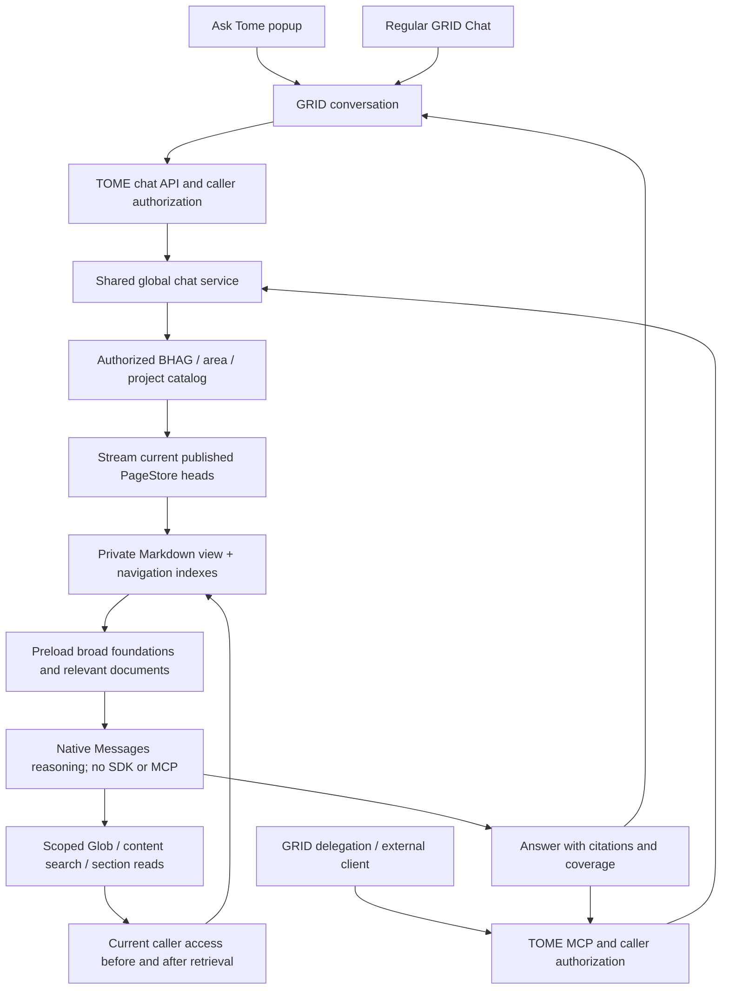

# TOME chat and ingestion

One native service runs project ingestion/chat with Claude Agent SDK and global
Ask Tome with direct Messages reasoning. No agent instance per project is needed.

| Operation | Context | Session and files |
| --- | --- | --- |
| Project ingestion | Project snapshot and authorized source credentials | A run for that project; its own wiki workspace |
| Project chat | Project snapshot, stable pages and permitted references | Resumable SDK session; project workspace |
| BHAG/area chat | Rollup snapshot and authorized child projects | Its own session; child wikis are read-only references |
| Global Ask Tome | Authorized navigation, broad foundations and supporting published evidence | User/conversation history; private published view per turn |

## Global context and retrieval

- `TOME_CHAT_AGENT_ID` (or the deployment-owned TOME app's
  `manifest.assistant.agentId`) binds a registered agent to native global
  retrieval. The server derives routing for new and existing browser GRID
  conversations from that identity, independently of popup visibility.
- TOME Settings → Assistant controls `platform_config.tome_assistant_popup_enabled`.
  It defaults off, affects Projects and wiki popups, and refreshes on visible
  clients every 30 seconds. Regular chat with the bound agent stays available.
- Conversation write and registered-agent use checks apply to both entry points;
  runtime metadata cannot substitute for the configured identity.



### MCP delegation and precise reads

- `tome_agent_search(query, scope?, session_id?)` is the primary global delegation
  tool. `tome_ask_global(question, scope?, session_id?)` aliases the same service.
  Both accept optional `verify_sources` for the runtime-controlled live comparison.
  Raw list/get tools and project-scoped `tome_ask` remain available.
- Both boundaries check the registered agent's use permission and derive the
  subject from authenticated credentials. MCP accepts existing user-owned TOME
  keys and linked OIDC credentials; service accounts cannot supply another user's
  identity. Native calls use a separate service credential.
- Optional BHAG/area/project scope narrows the authorized published export,
  including readable descendants. Internal snapshot POST verifies every selected
  entity against the current full scope. Search and model calls retain the same
  current-access checks as global browser chat.
- MCP sessions belong to one caller, are separate from GRID conversations, and
  reset on scope/access changes. A turn must complete successfully before model
  history is retained or MCP returns a completed result.
- Structured results include cited answers, consulted sources/entities, revision
  and capture dates, coverage, retrieval gaps and warnings. Upstream verification
  time stays null for published-wiki evidence. An output schema and JSON text
  support structured and older MCP clients. Response bounds include both copies.

### Files and context

```text
<private-turn-directory>/
  INDEX.md
  entities/
    <hashed-entity-id>/
      INDEX.md
      pages/
        charter.md
        roadmap.md
        architecture.md
        meetings/
        decisions/
```

- One canonical copy per entity; BHAG/area links live in navigation metadata.
- The canonical PageStore exports only published heads. Drafts, rejected revisions
  and tombstones are excluded; ingestion workspaces are never searched.
- Small corpora enter context in full. Larger corpora preload an authorized
  navigation index with overview excerpts, broad charters, question-relevant
  complete documents, then core progress/decision/memory documents.
- Navigation preserves entity identities and relationships before allocating
  space to overview excerpts. Known core-page paths prevent guessed reads.
  Excerpts shrink to fit the navigation budget;
  exceptionally large catalogs retain whole entries and report omitted entities.
- Remaining pages stay available through scoped search and reads. Context records
  the exact preloaded pages and any omitted navigation; no silent full-coverage claim.
- Citation references carry page path, revision id/time, content hash and capture
  time. Each corpus reports a capture window, rather than claiming an atomic
  cross-project snapshot. Published wiki evidence is not live upstream verification.

### Native functions

| Function | Purpose | Bounds |
| --- | --- | --- |
| `list_projects` | Entities and relationships | 200 entities/result, pagination |
| `list_project_pages` | Page titles, paths, headings and revision metadata | 200 pages/result, pagination |
| `glob_pages` | Paths with `*`, `?`, whole-segment `**`; optional entity/type filters | 200 paths/result, pagination |
| `search_pages` | Ranked keyword excerpts or literal ripgrep; optional entity/type/path filters | 20 excerpts/result, pagination and coverage |
| `read_project_page` | Published Markdown by character offset or line range | 48,000 characters/read, continuation offset |
| `search_confluence` | Optional live discovery within a project's configured site/space/root scope | Six matches/site, at most 12 returned |
| `read_confluence_page` | Optional current storage body and revision metadata | 24,000 code points/chunk, revision-bound continuation |

- Keyword ranking uses term frequency, corpus rarity and title/heading matches.
  It is not semantic/vector search. Literal search uses a fixed ripgrep invocation
  on allowlisted files only; no shell or model-selected command is exposed.
- Literal search caps at three matching lines/page, 1,000 matches, 8 MiB output
  and eight seconds. Truncated results cannot establish that evidence is absent.
- Budgets: 64 MiB corpus, 8 MiB/page, 20,000 pages; 128,000 initial context
  characters and 120,000 additional evidence characters; 12 model calls and
  32 function calls. Preparation is limited to 75 seconds and a turn to 270 seconds.
- Streaming honors backpressure; Mongo exports heads in small cursor batches.
  Integrity/count/hash checks reject incomplete or oversized views before reasoning.

### Optional live verification

- **TOME Settings → Assistant** sets `tome_live_verification_mode` in
  `platform_config`: **Off** (default), **On demand**, or **Automatic**.
  Popup visibility remains a separate setting.
- On demand requires the per-question **Tome + Confluence Live Search** choice.
  Automatic checks time-sensitive terms in the question or stale-evidence wording
  in the answer. This heuristic uses no fixed two-day ingestion-age threshold.
  **Tome Only Search** skips live verification for that question. Before an explicit
  choice, chat follows the runtime policy. Live search is unavailable while Off.
- Browser chat and both global MCP tools accept optional `verify_sources`:
  true requests verification, false skips it, omission follows runtime policy.
  Requests for verification while Off fail with a clear 409 error.
  A native runtime that does not acknowledge the policy cannot complete the turn;
  deploy matching UI and agent images before enabling verification.
- The native functions call the BFF directly. Caller-owned connected credentials
  are resolved for exact configured sites, with configured space/root filtering.
  OAuth tokens remain in the BFF. Current TOME authorization and a hashed,
  expiring turn grant restrict live reads to the selected caller-accessible scope.
  Source configuration and grant validity are checked again after each read.
- Independent source pages are read concurrently, up to three at a time. Reads
  require a complete storage body from one consistent revision. Search snippets
  and incomplete chunks cannot establish claim support.
- A separate native model pass compares answer claims with complete live bodies,
  marks supported/conflicting/unverified claims and revises contradicted claims.
  This is model-assisted review, not a formal correctness guarantee. No search
  results cannot establish that no event or launch occurred.
- `live_verification` in completion/MCP results reports status, claim checks,
  current source URLs/revisions/read times and gaps. Timeouts, access failures
  and failed comparison remain unverified. Published wiki dates and ingestion
  freshness are not changed by verification.
  Completed means the comparison finished; it does not mean every claim passed.
- Bounds: 20 live calls, 120,000 live body characters, 8 MiB HTTP responses,
  six pages and 65 seconds in the forced completion phase. Total turn bounds
  still apply; comparison adds one model request after primary reasoning and can
  add latency. Time-sensitive completion also searches for newly published pages.

### Isolation, authority and history

- The BFF authenticates conversation write access and assistant use permission.
  Trusted caller identity travels server-side; provider credentials stay outside
  global reasoning. Registered assistant identity controls display/use access.
- Current caller access is checked at snapshot completion, around search/read
  functions and around model responses. A changed scope stops the turn and resets
  private model history on the next turn.
- Root directory mode is 0700; staged files are 0400. Files are removed on completion,
  error and ordinary cancellation. Forced process termination may leave temporary
  files until the container is removed. This is a restricted capability boundary,
  not a separate OS sandbox. Arbitrary code execution would need stronger isolation.
- Mongo stores eight bounded user/assistant messages per user/conversation, with
  a seven-day TTL and a lease serializing active turns. Raw pages and tool results
  are not persisted. Each participant has separate model context.
- Live-enabled turns retain only user questions, discarding generated live answer
  text and provider bodies from private context. Subsequent turns must reread
  evidence under current access. Visible GRID history is retained separately.
- GRID retains visible messages and tool timelines under conversation permissions.
  Resetting private model context does not erase already-shared visible messages.
- Ingestion still writes under each project's lock and keeps its existing source
  connector MCPs. Global retrieval never borrows those credentials or SDK sessions.
- MCP callers receive the composed result, rather than the internal tool timeline.
  Their outer GRID agent owns the visible conversation; MCP retains only private
  caller/session model history under the same eight-message/seven-day bounds.
