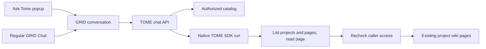

# TOME chat and ingestion

One native TOME service executes separate Claude Agent SDK runs. It does not keep
one permanent agent per project.

| Operation | Context | Session and files |
| --- | --- | --- |
| Project ingestion | Project snapshot and authorized source credentials | A run for that project; its own wiki workspace |
| Project chat | Project snapshot, stable pages, and permitted references | A resumable chat session; project workspace |
| BHAG/area chat | Rollup snapshot and authorized child projects | Its own chat session; child wikis are read-only references |
| Global Ask Tome | Caller-readable catalog with BHAG/area relationships | A user/conversation session; current pages retrieved through tools |

## Global retrieval

- The initial context contains entity names, types, slugs, and hierarchy labels.
- The agent retrieves relevant wiki and source-specific pages on demand and cites
  their project/page paths. It reports gaps and the scope it actually inspected.
- Files stay in their existing project workspaces. Global chat neither merges
  folders nor places every document in the model context.
- Global chat exposes only catalog/page retrieval tools, with no filesystem,
  connector, or write tools. Project chat remains the surface for wiki edits.
- Each turn refreshes the authorized catalog. A changed catalog starts a new SDK
  context; page retrieval also rechecks the caller's current access.
- GRID stores messages and tool timelines. Native SDK resume state is isolated by
  conversation and user subject. Concurrent turns for one session are serialized.
- The registered assistant identity controls use permission and display. Native
  conversations execute in TOME rather than the Dynamic Agents model runtime.

Ingestion still writes each project's wiki under its project lock. Global reads
use current stored pages and do not borrow an ingestion run's credentials or
working directory.
