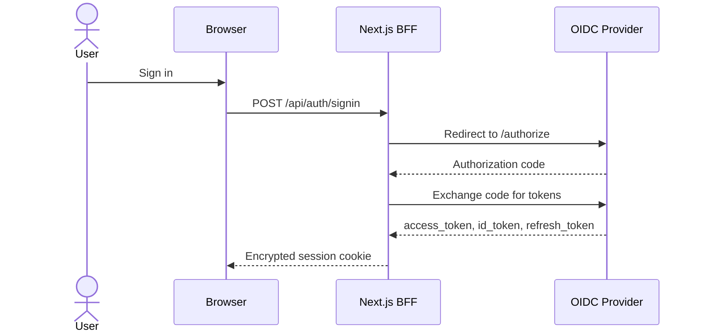
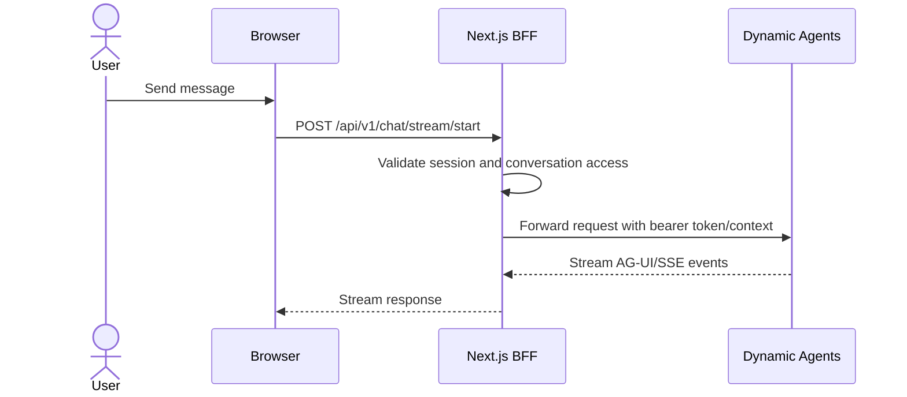

# Authentication Flow

The CAIPE UI uses NextAuth for browser sessions and forwards validated server
credentials from the BFF to backend services such as Dynamic Agents, RAG, and
AgentGateway.

## Components

- **Browser**: renders the React UI and calls Next.js API routes.
- **Next.js BFF**: owns session validation, RBAC checks, service-account flows,
  and backend proxying.
- **OIDC provider**: Keycloak, Okta, Azure AD, or another OpenID Connect IdP.
- **Dynamic Agents**: validates bearer tokens for direct service calls and
  receives BFF-forwarded chat requests.
- **OpenFGA / AgentGateway**: enforces tool and MCP-server access on the data
  path when RBAC runtime is enabled.

## Login



## Chat Request



The browser does not need direct network access to Dynamic Agents. Set
`DYNAMIC_AGENTS_URL` on the UI server so the BFF can reach the runtime.

## Token Refresh

NextAuth refreshes access tokens before expiry when the provider issues refresh
tokens. A rejected refresh token (`invalid_grant` / `invalid_token`) is not
retried. A still-valid access token may finish its lifetime; otherwise the UI
prompts for sign-in. Network, WAF and malformed-response failures back off for
60 seconds while the access token remains usable. Client force-refresh requests
honor both suppression and `OIDC_ENABLE_REFRESH_TOKEN=false`.

Failure state is keyed by a SHA-256 fingerprint of issuer, client and refresh
token, never by raw credentials. A bounded process-local cache and MongoDB
`auth_refresh_failures` collection protect read-only session requests and stale
cookies across replicas. Terminal records last 24 hours (the UI session lifetime)
and transient records last 60 seconds; Mongo TTL cleanup removes old records.
The application needs permission to create the TTL index. If MongoDB is absent
or unavailable, protection is process-local only. Concurrent requests within a
process share an exchange; a newer, usable token in the shared token store can
be adopted after a peer refresh. This is not a distributed refresh lock: rollout
testing must still exercise simultaneous refresh-token rotation across replicas.

### Internal token endpoint

Set `OIDC_TOKEN_ENDPOINT` to a trusted server-only token URL to keep refresh
traffic off the browser-facing WAF. If unset, a Keycloak realm-shaped
`OIDC_DISCOVERY_URL` (`.../realms/<realm>`) supplies the internal token endpoint.
Other providers use their discovery document's `token_endpoint`; no Keycloak
route is guessed for them. Compose and Helm leave the explicit override empty
so a custom realm/discovery URL is respected.

```bash
OIDC_ISSUER=https://idp.example.com/realms/example
OIDC_DISCOVERY_URL=http://keycloak:8080/realms/example
# Optional; set explicitly for nonstandard internal routes:
OIDC_TOKEN_ENDPOINT=http://keycloak:8080/realms/example/protocol/openid-connect/token
```

Keep the public issuer unchanged for issuer validation and browser SSO. These
settings affect the UI's server-side refresh exchange, not the browser redirect
or NextAuth authorization-code callback. Internal HTTP is allowed for trusted
service networks; use HTTPS or transport encryption where that network is not
trusted. Credential-bearing POSTs never follow redirects, use no-store caching
and a 10-second timeout. Discovery cannot downgrade HTTPS to HTTP. Endpoint URLs
with userinfo, fragments or non-HTTP(S) schemes are rejected. Provider error
bodies and transport exceptions are not logged by the refresh path.

Before production rollout, verify internal DNS/connectivity from each UI replica,
normal login, concurrent refresh rotation, a deliberately rejected refresh token,
and transient 403/429/5xx recovery. Confirm refresh traffic is absent from public
WAF token-endpoint logs. Do not weaken WAF rules or broaden user roles to address
this session issue; authorization-related write 403s are a separate concern.

## Required Environment

```bash
SSO_ENABLED=true
OIDC_ISSUER=https://idp.example.com/realms/caipe
OIDC_CLIENT_ID=caipe-ui
OIDC_CLIENT_SECRET=<secret>
NEXTAUTH_SECRET=<random-secret>
NEXTAUTH_URL=https://caipe.example.com
DYNAMIC_AGENTS_URL=http://dynamic-agents:8001
```

For local Docker Compose with bundled Keycloak, `.env.example` provides working
development defaults.
