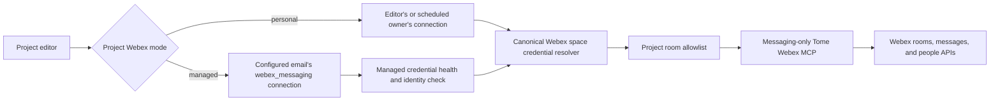

# Implementation Plan: Managed Webex Messaging for Tome Space Ingest

**Status:** Implemented
**Date:** 2026-09-09  
**Scope:** Tome Webex space discovery, manual ingest, and scheduled auto-ingest

## Summary

Add a deployment-configured, global Webex user account that Tome can use to
ingest selected Webex spaces. Users add that account to the Webex spaces they
want Tome to read. Projects can then explicitly choose either:

- **My Webex connection**: preserve user-scoped Webex ingestion.
- **Managed Webex account**: read through the configured global account.

The OAuth provider `webex_messaging` remains available to every user. One
specific `webex_messaging` connection is designated as managed by the
deployment-configured account email. The connector is ordinary; CAIPE resolves
the account's current OIDC subject dynamically and treats that connection as
special.

The managed account is messaging-only. It must never gain meeting, write,
administrator, compliance, AgentGateway, dynamic-agent, or general chat
authority.

## Agreed Decisions

- Use one global generic Webex user account, not separate accounts per team.
- The generic account performs its own CAIPE login and Webex OAuth flow.
- An administrator cannot authorize Webex while pretending to be that account.
- Make `webex_messaging` available for all users to connect.
- Configure only the managed account's exact trusted SSO email and provider.
- Resolve its current CAIPE OIDC subject from the user directory instead of
  storing realm-specific IDs in deployment configuration.
- Verify the connected Webex token returns that same email from `/people/me`;
  discover Webex person and organization IDs dynamically.
- Show the managed project option only while that exact connection is healthy.
- Preserve both personal and managed Webex space ingestion.
- Select Webex credential mode once per project. Do not mix personal and
  managed Webex spaces within one project/run.
- Keep Webex meeting and meeting-series ingestion separate and user-scoped.
- Do not migrate existing projects automatically.
- Do not repair, retry, requeue, backfill, or alter existing ingest runs as part
  of this feature.

## Goals

- Remove dependence on an individual project user's Webex token for projects
  that opt into managed Webex space ingestion.
- Let users add the global account to a Webex space and then attach an
  authorized space to a Tome project.
- Preserve the current personal Webex path.
- Keep the managed OAuth token inaccessible to browser clients and unrelated
  internal services.
- Fail clearly when the managed account is disconnected or removed from a
  configured space.
- Keep manual and scheduled ingest attribution separate from the Webex identity
  used to read messages.

## Non-Goals

- Webex meeting, recording, summary, or transcript access.
- Sending messages or managing spaces/memberships.
- Organization-wide compliance access.
- A Webex bot or Webex Service App.
- Making the managed credential available to AgentGateway, dynamic agents,
  workflows, or normal Tome chat.
- Automatically adding the managed account to Webex spaces.
- Automatically migrating existing project source configuration.

## Architecture



The human or scheduler remains the ingest actor. The managed account is only
the source-reading identity.

## OAuth Connector

Register a separate OAuth connector:

```yaml
oauthConnectors:
  - provider: "webex_messaging"
    name: "Webex Messaging"
    clientIdEnv: "WEBEX_MESSAGING_CLIENT_ID"
    clientSecretEnv: "WEBEX_MESSAGING_CLIENT_SECRET"
    authorizationUrl: "https://webexapis.com/v1/authorize"
    tokenUrl: "https://webexapis.com/v1/access_token"
    scopes:
      - "spark:kms"
      - "spark:rooms_read"
      - "spark:messages_read"
      - "spark:people_read"
    redirectUri: "https://<environment-host>/api/credentials/oauth/webex_messaging/callback"
```

For GRID, the redirect URI is:

```text
https://grid.outshift.io/api/credentials/oauth/webex_messaging/callback
```

The redirect URI configured in Webex and the deployment must match exactly.
Webex may add `spark:kms` implicitly rather than presenting it as a selectable
scope. CAIPE should still include it in the authorization request.

Do not request:

- `spark:all`
- `spark:mcp`
- any membership or message write scope
- `identity:people_read`
- `spark-admin:*` or `spark-compliance:*`
- any `meeting:*` scope

OAuth client credentials remain in the deployment secret manager. Access and
refresh tokens remain encrypted in CAIPE's provider-connection store. No token
is stored in `values.yaml`, a project document, or a Tome run document.

## Managed Identity Configuration

Proposed environment configuration:

```yaml
TOME_MANAGED_WEBEX_MESSAGING_ENABLED: "true"
TOME_MANAGED_WEBEX_MESSAGING_PROVIDER: "webex_messaging"
TOME_MANAGED_WEBEX_MESSAGING_ACCOUNT_EMAIL: "<exact-full-email>"
```

Identity resolution:

- `ACCOUNT_EMAIL` is the exact generic-account email; a suffix such as
  `@cisco.com` is insufficient.
- CAIPE resolves its current Keycloak/OIDC subject from the `users` directory.
- CAIPE finds that subject's connected `webex_messaging` credential.
- Webex `/people/me` must return the same exact email. Person and organization
  IDs are provider metadata and are not deployment configuration.

The provider must be configurable rather than hardcoded, but production should
set it to `webex_messaging`.

## Initial Connection

1. Configure the generic account's exact email.
2. Create the generic account in CAIPE/Keycloak if it does not exist.
3. Log into CAIPE as that exact account.
4. Open `/credentials` as the generic account.
5. Connect **Webex Messaging**, authenticating as the same generic Webex user.
6. CAIPE resolves the current OIDC subject from the user directory and probes
   Webex `/people/me` through that subject's connection.
7. Mark the managed capability healthy only when `/people/me` returns the
   configured email.

The application must never transfer a token from an administrator's connection
or attempt to impersonate the generic Webex user.

## Connection Availability and UI Gating

Add a server-side managed-capability check. The managed option is available
only when all of these are true:

- The feature is enabled.
- The configured provider exists and is enabled.
- The configured email resolves to exactly one CAIPE user subject.
- That subject has a connection for the configured provider.
- The connection status is `connected`.
- Token refresh succeeds.
- `/people/me` includes the configured exact email.

Return only a safe capability result to the browser, for example:

```json
{
  "enabled": true,
  "available": true,
  "provider": "webex_messaging",
  "displayName": "Managed Webex account"
}
```

Do not return the resolved owner subject, connection ID, token, Webex person
ID, or Webex organization ID.

UI rules:

- Healthy connection: show **Managed Webex account** as a project option.
- Feature disabled or never connected: hide the option.
- Existing project already configured as managed, but connection becomes
  unhealthy: preserve and display the selected mode, show **Managed Webex
  account needs reconnection**, and block ingestion.
- Never switch an unhealthy managed project to personal automatically.

Use a short-lived cached health result so rendering settings pages does not
refresh and probe Webex unnecessarily.

## Project Data Model

Add explicit project-level Webex source credential settings. Proposed logical
shape:

```yaml
sources:
  webex_credential_mode: "personal" # personal | managed
  webex_credential_provider: "webex_messaging"
  webex_rooms: []
```

Compatibility rules:

- Missing mode means the existing personal behavior.
- Missing provider on an existing project means the legacy `webex` provider.
- A newly configured personal messaging project stores `webex_messaging`.
- Managed mode ignores a project-supplied provider and always uses the
  deployment-configured provider.
- The backend rejects unknown modes/providers.
- One mode covers every Webex room attached to the project.
- Switching modes is explicit and audited.
- Switching to managed is rejected until the managed account can access every
  attached Webex room.
- No database backfill or automatic rewrite is required.

## Source Picker and Source Authorization

### Personal mode

- Preserve the existing **Connect Webex** path.
- Use the signed-in user's selected personal provider connection.
- List only rooms that their personal Webex token can access.

### Managed mode

- Display that the project will ingest through the managed Webex account.
- Resolve the managed token only on the server.
- List only the intersection of:
  - rooms the global account can access; and
  - rooms where the current signed-in user is also a live Webex member.
- Show the managed account's full configured email with instructions to add it
  to the desired rooms, then use the existing refresh action.
- Validate each selected room with `GET /rooms/{roomId}` using the managed
  connection and recheck the current user's membership before saving or
  ingesting it.
- If the room is inaccessible, tell the user to add the managed Webex account
  to the space.

The live membership intersection proves that the selecting user may access the
room and that Tome's managed identity can read it. Normal project authorization
continues to govern who may edit the source selection and read ingested output.

Do not expose an unfiltered list of every room visible to the global account.

## Canonical Credential Resolution

Add one server-only Webex space credential resolver and use it from:

- project source discovery;
- source mutation validation;
- Tome preflight;
- manual ingest preparation;
- scheduled auto-ingest;
- credential-health reporting.

Resolver behavior:

| Project mode | Credential owner | Provider |
|---|---|---|
| Personal, legacy | Current user/manual or configured schedule owner/auto | Stored legacy `webex` |
| Personal, messaging | Current user/manual or configured schedule owner/auto | `webex_messaging` |
| Managed | Subject dynamically resolved from the configured account email | Deployment-configured provider (`webex_messaging`) |

For managed mode:

- Resolve GitHub and Atlassian credentials from the human/scheduled owner as
  usual.
- Remove any personal Webex token from the request.
- Inject only the resolved managed messaging credential.
- Keep the initiating human as the manual run actor.
- Use a scheduler/system actor for scheduled execution while preserving the
  configured project owner/steward in audit metadata.
- Never accept an owner subject or connection ID supplied by the browser.
- Never fall back to a personal Webex connection.

## Managed Credential Security Boundary

The principal risk is compromise of the single global account or use of CAIPE
as a confused deputy to access every Webex space that account can read.

Treat the configured `(provider, account-email)` identity and its dynamically
resolved owner subject as protected:

- Do not return its access token through the generic credential exchange route.
- Do not inject it through AgentGateway's provider-token route.
- Do not grant `secret_ref:<provider-connection-id>#use` to other principals.
- Do not include it in normal Tome chat requests.
- Do not expose it to dynamic agents, workflows, arbitrary MCP servers, or
  user-configured credential sources.
- Block normal deletion/replacement of the protected connection unless an
  explicit operator-controlled recovery path is enabled in a future design.
- Keep the generic CAIPE identity out of teams, projects, agent permissions,
  and administrative roles.
- Consider disabling its interactive CAIPE login after connection setup; the
  user-directory record remains available for subject resolution and backend
  OAuth refresh does not need an active browser session.
- Log identity-health changes, managed-mode selections, and managed ingest
  attempts without logging tokens or raw credential IDs.

Other users' `webex_messaging` connections remain ordinary and user-managed.
The protected-pair checks must not restrict their connect, refresh, or revoke
flows.

A single global account intentionally creates one Webex membership blast
radius. Application controls reduce misuse through CAIPE, but compromise of the
Webex login or OAuth refresh token would still expose every space that account
can access. Keep its space memberships limited to spaces explicitly intended
for Tome ingestion and protect the Webex identity with the organization's MFA,
SSO, and conditional-access controls.

## Tome Agent and Tool Isolation

The current Tome Webex connector combines messaging and meeting tools. Add an
explicit messaging-only capability for `webex_messaging`.

Allowed tools:

- list/get project-attached Webex rooms;
- list/get messages in those rooms;
- resolve message authors through the People API.

Forbidden tools/capabilities:

- meetings, recordings, transcripts, or summaries;
- memberships;
- room/message writes;
- Webex-hosted MCP access;
- any room outside the project's existing room-ID allowlist.

The same Webex wiki page templates and source prefix can be reused. Tool
registration, allowed-tool names, and prompts must all exclude meeting
enrichment when the credential is `webex_messaging`; merely omitting meeting
scopes is insufficient because it leaves the agent able to make predictable
failing calls.

Managed credentials are initially ingest-only. Tome chat reads the reviewed
wiki pages and does not receive the managed Webex token. This prevents chat
from bypassing ingest/review controls to read live space content.

## Manual Ingest

- Preserve the user's project authorization and run attribution.
- Resolve the project's configured Webex credential mode during queued-run
  preparation, not only in the original request session.
- In managed mode, validate global connection health and access to every
  attached room before dispatch.
- Fail the run preparation clearly if any managed room is inaccessible.
- Do not continue with a partial Webex source set.
- Do not fall back to the triggering user's Webex token.

## Scheduled Auto-Ingest

- Resolve Webex independently from the project's GitHub/Atlassian credential
  owner.
- Managed-Webex-only projects do not require the scheduled owner to connect
  Webex.
- Mixed-source projects still require the configured personal owner for any
  GitHub/Atlassian credentials they consume.
- Refresh and monitor the managed Webex connection globally, even if no project
  schedule fires during the Webex refresh-token lifetime.
- Group health checks so multiple managed projects do not refresh/probe the
  same connection independently.
- When unhealthy, record a visible skipped/failed reason and do not enqueue an
  ingest.
- Reconnection does not automatically retry, requeue, or backfill missed runs.

## Failure Behavior

| Condition | Required behavior |
|---|---|
| Managed connection absent | Hide option for new selection; existing managed projects show unavailable and cannot ingest. |
| Token refresh fails | Mark managed capability unhealthy; do not fall back. |
| `/people/me` identity mismatch | Treat as security failure and block all managed use. |
| Managed account not in a room | Fail preflight with instructions to add the account. |
| Managed account removed later | Block the next ingest and surface the inaccessible room. |
| Caller lacks CAIPE space authorization | Do not show or attach the room even if the managed account can read it. |
| Generic CAIPE account calls exchange/injection | Deny access to its protected managed connection. |
| Existing run already failed | Leave it unchanged; this feature performs no recovery. |

## Observability

Add an administrator-visible managed Webex health row containing only:

- configured/connected/healthy state;
- safe display label and masked email;
- last successful token refresh;
- last successful identity probe;
- last error category;
- count of managed projects and attached rooms.

Project settings and ingest logs should show:

- `Webex credential: personal` or `Webex credential: managed`;
- inaccessible-room errors;
- managed connection unavailable/reconnection required;
- no owner subject, person ID, organization ID, connection ID, or token.

## Implementation Areas

Expected code touch points:

```text
ui/src/lib/credentials/
  OAuth connector bootstrap/profile support for webex_messaging
  protected managed-connection checks

ui/src/app/api/credentials/
  connect/callback profile validation
  exchange/inject/revoke protection for the managed owner/provider pair

ui/src/lib/tome/
  canonical Webex space credential resolver
  ingest request credential routing
  managed credential health
  auto-ingest integration

ui/src/app/api/projects/source-options/
  personal/managed discovery and safe capability response

ui/src/app/api/tome/projects/[slug]/preflight/
  mode-aware Webex access validation

ui/src/components/projects/source-pickers/
ui/src/components/tome/
  project-level credential-mode selector, availability gating, and errors

ui/src/types/projects.ts
  additive Webex credential mode/provider fields

ai_platform_engineering/agents/tome/tome_agent/agent/
  messaging-only Webex credential/tool capability

deployment values
  OAuth connector, Vault references, non-secret managed identity settings,
  and final unique image tags
```

Reuse the current room-ID allowlist in the Tome connector. Do not build a
second ingestion engine.

## Test Plan

### Webex validation before implementation completion

- Confirm the generic user can list an attached test room.
- Confirm it can list/get messages and resolve author names with exactly the
  four messaging scopes.
- Confirm whether messages created before the account joined are available.
- Confirm removing the account causes room/message access to fail.
- Confirm no meeting endpoint works with the messaging-only token.

### Unit and route tests

- Managed capability hidden when disabled, absent, unhealthy, or mismatched.
- Managed capability shown for the exact healthy owner/provider pair.
- Another user's healthy `webex_messaging` connection does not satisfy managed
  availability.
- Personal and managed modes choose the correct owner/provider.
- Legacy projects retain the legacy personal provider.
- Browser-supplied owner/connection identifiers are ignored or rejected.
- Managed token is denied through credential exchange and AgentGateway
  injection.
- Other users can still manage their own `webex_messaging` connections.
- Source discovery filters by both Webex access and CAIPE space authorization.
- Mode switching validates all existing rooms.
- No personal fallback occurs when managed resolution fails.
- Managed requests contain no meeting tools or meeting prompt guidance.
- Managed credential is absent from chat requests.
- Mixed GitHub/Atlassian plus managed Webex runs route each provider correctly.
- Auto-ingest records a visible failure without enqueueing when managed health
  fails.

### End-to-end checks

- Connect the generic account and observe the managed option appear.
- Add the account to an authorized Webex test space.
- Select that space in managed mode and run manual ingest.
- Run scheduled ingest without a personal Webex connection.
- Disconnect/remove access and observe the managed option/error behavior.
- Reconnect without automatically retrying an old failed run.

## Rollout

1. Add the connector and code with managed mode disabled.
2. Build and validate `webex_messaging` OAuth for an ordinary user.
3. Configure the generic account's exact email.
4. Connect the generic account; CAIPE discovers its current subject and Webex
   profile dynamically.
5. Verify the exact-scope and historical-message tests in one test room.
6. Enable managed mode for one test project explicitly.
7. Validate manual ingest, scheduled ingest, review flow, and failure behavior.
8. Expand to other projects through explicit project settings only.

No deployment command is part of implementation unless separately requested.
After code changes, the implementation handoff must automatically:

- run relevant UI and Tome-agent tests plus lint/build checks;
- build unique tags for every changed runtime image (`caipe-ui` and
  `caipe-tome-agent` if both change);
- load those images into the local Kind cluster;
- update the corresponding image tags in the deployment values file;
- not run Helm or deploy the release.

## Acceptance Criteria

- Every user can connect the `webex_messaging` OAuth provider for themselves.
- Only the provider connection owned by the CAIPE subject currently resolved
  from the configured exact email qualifies as the managed identity.
- The managed project option appears only when that connection is healthy and
  identity-verified.
- Existing managed projects remain visibly configured when health later fails,
  but ingest is blocked.
- Projects explicitly choose personal or managed Webex space credentials.
- Existing projects remain behaviorally unchanged until explicitly edited.
- Managed Webex ingest can read only project-attached rooms that both the
  triggering user and global account have joined.
- The managed token is messaging-only and cannot be retrieved through generic
  exchange/injection/chat paths.
- Manual and scheduled ingestion never fall back to another Webex identity.
- Meeting ingestion is unchanged.
- No existing project, source, run, or persisted failure is automatically
  migrated, repaired, retried, requeued, or backfilled.
